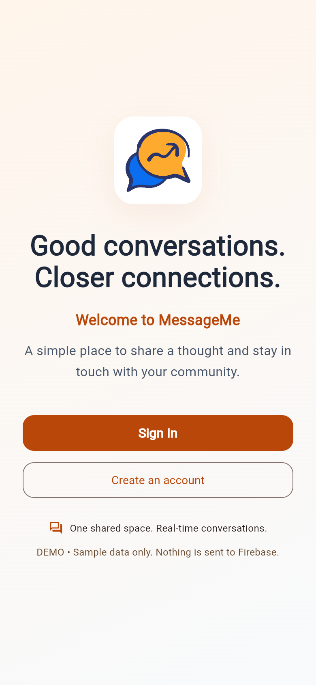
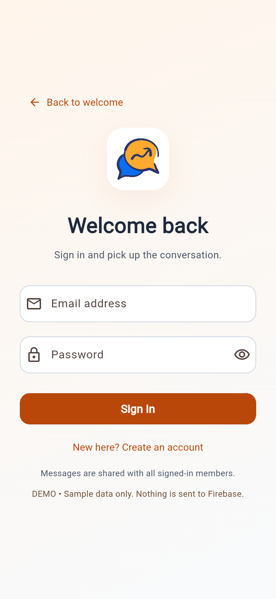
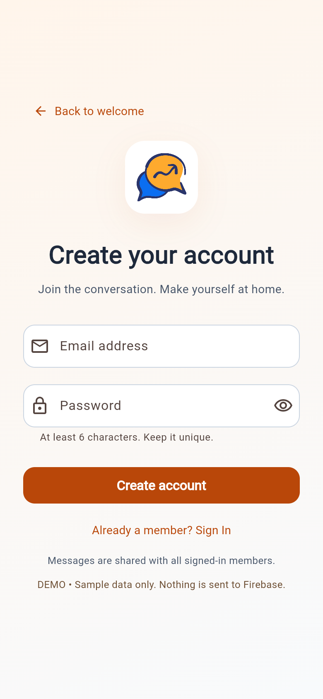
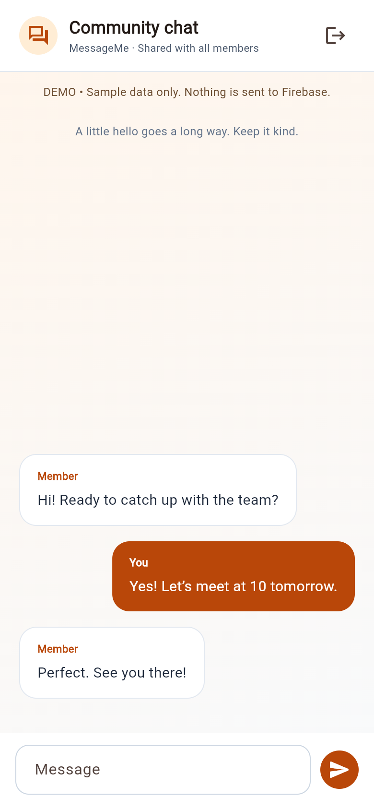

# MessageMe

A focused community chat application built with Flutter and Firebase. Sign in, join one shared room, and exchange messages in real time through a responsive mobile and desktop interface.

## Features

- Email/password registration and sign-in with Firebase Authentication.
- A shared Firestore conversation with the latest 100 messages, newest at the bottom.
- Responsive layouts, labelled inputs, password visibility controls, keyboard navigation, and loading/error states.
- Protected chat navigation, clean sign-out, duplicate-send prevention, and draft retention on failed sends.
- An explicit local demo for previews, screenshots, and automated tests without Firebase access.

**Scope:** this is a shared community room, not private messaging. All authenticated members can read the room. End-to-end encryption, attachments, moderation, push notifications, and private conversations are not implemented.

## Stack and structure

Flutter / Dart, Material 3, Firebase Core, Firebase Authentication, and Cloud Firestore. Tested with Flutter 3.38.9 / Dart 3.10.8.

```text
lib/
  main.dart                  Startup, configuration, theme, and routes
  screens/                   Welcome, shared authentication form, and chat
  services/chat_service.dart Firebase adapter, demo adapter, and validation
  widget/app_layout.dart     Shared responsive layout and branding
firestore.rules              Rules for the shared room
firebase-config.example.json Placeholder web configuration
test/widget_test.dart       Local service and widget tests (no live Firebase)
```

## Prerequisites

- Flutter 3.38 or later with Dart 3.10.8 or later.
- Chrome for web development; Android Studio / SDK for Android builds.
- A Firebase project for live authentication and messaging. A Firebase project is **not** needed for the demo.

```sh
flutter pub get
flutter doctor
```

## Local demo (no Firebase)

```sh
flutter run -d chrome --dart-define=DEMO_MODE=true
```

Enter any valid email-shaped demo address and a dummy password. Registration requires at least six characters. The demo is labelled on every page, uses sample messages, and never initializes Firebase. Messages and the session are memory-only and reset when the app reloads. Do not use real credentials in the demo.

## Firebase setup

1. Create/select a Firebase project and enable **Authentication → Email/Password**.
2. Create a Cloud Firestore database. The app uses the existing `messages` collection; no schema migration is needed.
3. Review `firestore.rules`, then deploy to your chosen project explicitly:

   ```sh
   firebase login
   firebase deploy --only firestore:rules --project YOUR_PROJECT_ID
   ```

   Install the Firebase CLI separately if needed. The rules allow authenticated room reads and restrict new messages to the authenticated sender, server timestamps, and 1–2000 characters. Edits/deletes are denied. They do not provide application-wide abuse quotas or moderation. No rules are deployed automatically by the app or tests.

### Web

Register a Firebase **web app** and copy its client configuration from Firebase Console:

```sh
# PowerShell
Copy-Item firebase-config.example.json firebase-config.local.json
# macOS / Linux: cp firebase-config.example.json firebase-config.local.json
```

Replace the placeholders in the local file, then run:

```sh
flutter run -d chrome --dart-define-from-file=firebase-config.local.json
```

Ensure your local/deployed hostname is allowed in Firebase Authentication's **Authorized domains**. The required values are `FIREBASE_API_KEY`, `FIREBASE_APP_ID`, `FIREBASE_MESSAGING_SENDER_ID`, `FIREBASE_PROJECT_ID`, and `FIREBASE_AUTH_DOMAIN`. The local config is ignored by Git. Firebase web configuration is embedded in client builds; security must be enforced by Authentication and database rules. Never put Admin SDK keys, service-account JSON, passwords, or signing secrets in client configuration.

If configuration is missing or initialization fails, the app displays a safe setup screen rather than an unhandled blank page.

### Android

Register Android application ID `at.obada.messegeme_app` in the same Firebase project. Download its matching `google-services.json` into `android/app/` (ignored by Git), then:

```sh
flutter run -d YOUR_ANDROID_DEVICE_ID
```

The Google Services Gradle plugin is declared in `android/settings.gradle.kts`. For production distribution, configure your own release signing; the inherited Android template still uses debug signing for release. Accept SDK licences yourself with `flutter doctor --android-licenses` if required. Native builds were not validated in this audit.

Other platform runner folders are retained, but Firebase configuration and native builds for those platforms are not validated. iOS requires a matching local `GoogleService-Info.plist` and Apple tooling.

## Validate and build

```sh
flutter analyze
flutter test
# Live application: provide your local Firebase client configuration
flutter build web --release --dart-define-from-file=firebase-config.local.json
# Local sample build, deliberately separate from the live output
flutter build web --release --dart-define=DEMO_MODE=true --output=build/web-demo
```

Tests use local fakes/demo services, never real users or Firestore. `build/`, local Firebase files, `.env` files, signing material, SDK caches, and logs are ignored. A previously committed Android Firebase client config is removed from current tracking; historical commits are unchanged. Review Firebase API restrictions/rules in the Firebase/Google Cloud consoles.

Flutter's engine can request fallback fonts from Google even when app assets are local; a completely offline web deployment has not been validated.

## Screenshots

Captured from the **local demo** with synthetic content. No real user accounts, passwords, or messages are shown.

| Welcome | Sign in | Create account |
| --- | --- | --- |
|  |  |  |



Four representative existing captures are selected above. The remaining original captures are retained in `docs/screenshots/`; the live Firebase service was not used for the portfolio review.

See [audit notes](docs/AUDIT.md) for changes, validation results, and remaining setup.
